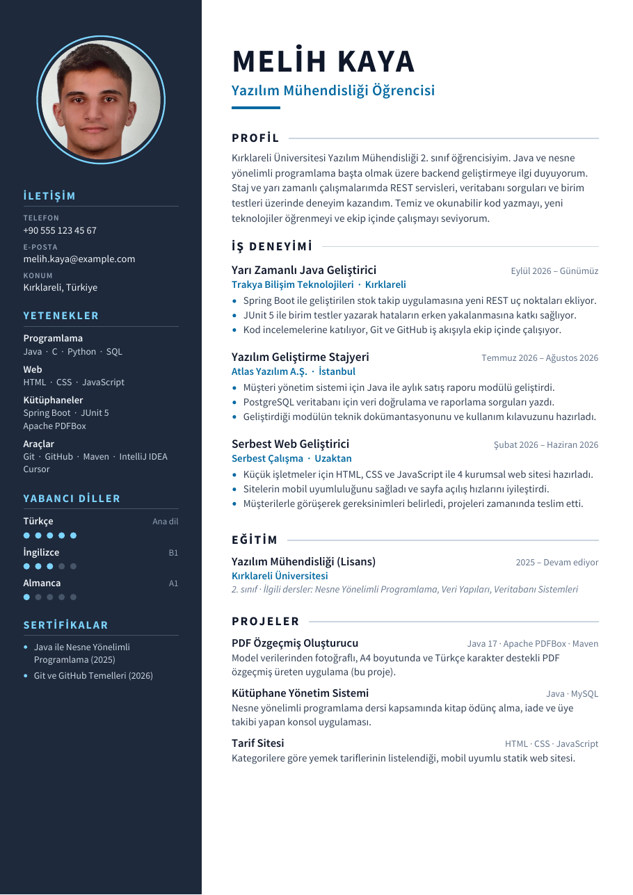
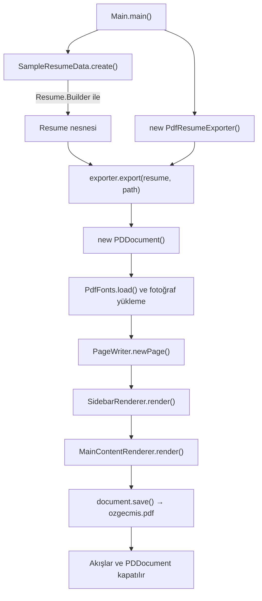

# Java PDF Özgeçmiş Oluşturucu

Java ve **Apache PDFBox** kütüphanesi kullanarak A4 boyutunda, fotoğraflı ve Türkçe karakter destekli bir PDF özgeçmiş (CV) üreten komut satırı uygulaması.

| | |
|---|---|
| **Hazırlayan** | Melih Kaya |
| **Öğrenci No** | 5250505034 |
| **Bölüm** | Kırklareli Üniversitesi – Yazılım Mühendisliği (2. sınıf) |
| **Ödev** | Final Değerlendirme Ödevi – 1 |

> Ödev yönergesine uygun olarak özgeçmişteki iletişim bilgileri, **3 iş deneyimi** ve sertifikalar **hayalidir**.

<p align="center">
  
</p>

📄 Örnek çıktı: [`ornek-cikti/ozgecmis.pdf`](ornek-cikti/ozgecmis.pdf)

---

## İçindekiler

- [Özellikler](#özellikler)
- [Kullanılan Teknolojiler](#kullanılan-teknolojiler)
- [Proje Yapısı](#proje-yapısı)
- [Kurulum ve Çalıştırma](#kurulum-ve-çalıştırma)
- [Kendi Bilgilerinizi Eklemek](#kendi-bilgilerinizi-eklemek)
- [Programın Çalışma Akışı](#programın-çalışma-akışı)
- [Sınıflar ve Görevleri](#sınıflar-ve-görevleri)
- [Kullanılan Bileşenler ve Nesneler](#kullanılan-bileşenler-ve-nesneler)
- [Nesne Yaşam Döngüsü](#nesne-yaşam-döngüsü)
- [Erişim Düzenleyiciler](#erişim-düzenleyiciler)
- [Tasarım Kararları](#tasarım-kararları)
- [Yapay Zeka (Dil Modeli) Kullanımı](#yapay-zeka-dil-modeli-kullanımı)
- [Lisanslar](#lisanslar)

---

## Özellikler

- A4 boyutunda (595 × 842 punto) PDF üretir; içerik sığmazsa otomatik olarak yeni sayfa açar.
- Profil fotoğrafını daire şeklinde kırparak ekler (JPG veya PNG).
- `ç, ğ, ı, İ, ö, ş, ü` gibi Türkçe karakterleri doğru gösterir (font PDF'e gömülür).
- Bölümler: kişisel bilgiler, profil, **3 iş deneyimi**, eğitim, projeler, yetenekler, yabancı diller, sertifikalar.
- Uzun metinleri sütun genişliğine göre otomatik olarak satırlara böler.
- PDF üretimi `main` metodunda değil, **ayrı bir sınıfta** (`PdfResumeExporter`) yapılır.
- Grafik arayüz yoktur; program komut satırından çalışır.

## Kullanılan Teknolojiler

| Teknoloji | Sürüm | Ne için kullanıldı |
|---|---|---|
| Java (JDK) | 17+ | Programlama dili |
| Apache Maven | 3.8+ | Bağımlılık yönetimi ve derleme |
| [Apache PDFBox](https://pdfbox.apache.org/) | 3.0.4 | PDF dosyası oluşturma, metin/şekil/resim çizme |
| Source Sans Pro | — | Türkçe karakter destekli, PDF'e gömülen yazı tipi |

## Proje Yapısı

```text
java-pdf-ozgecmis/
├── pom.xml                               # Maven yapılandırması (PDFBox bağımlılığı)
├── README.md
├── docs/
│   └── onizleme.png                      # README'deki önizleme görseli
├── ornek-cikti/
│   └── ozgecmis.pdf                      # Programın ürettiği örnek PDF
└── src/main/
    ├── java/com/ozgecmis/
    │   ├── Main.java                     # Giriş noktası, sadece nesneleri oluşturur
    │   ├── data/
    │   │   └── SampleResumeData.java     # Özgeçmiş verileri (ad, deneyim, eğitim...)
    │   ├── export/
    │   │   └── ResumeExporter.java       # Dışa aktarma arayüzü (interface)
    │   ├── model/                        # Veriyi temsil eden sınıflar
    │   │   ├── Resume.java               # Ana model + Builder
    │   │   ├── PersonalInfo.java
    │   │   ├── Experience.java
    │   │   ├── Education.java
    │   │   ├── Project.java
    │   │   ├── SkillGroup.java
    │   │   └── Language.java
    │   └── pdf/                          # PDF üretimiyle ilgili tüm kod
    │       ├── PdfResumeExporter.java    # PDF üretimini yöneten sınıf
    │       ├── PageWriter.java           # Sayfa ekleme ve çizim işlemleri
    │       ├── SidebarRenderer.java      # Sol kenar çubuğu
    │       ├── MainContentRenderer.java  # Sağ ana sütun
    │       ├── PdfFonts.java             # Font yükleme
    │       ├── TextWrapper.java          # Metni satırlara bölme
    │       └── Theme.java                # Renk ve ölçü sabitleri
    └── resources/
        ├── fonts/                        # Source Sans Pro (TTF) + lisans dosyası
        └── images/
            └── profil.jpg                # Özgeçmiş fotoğrafı
```

## Kurulum ve Çalıştırma

**Gereksinimler:** JDK 17 veya üzeri (proje JDK 21 ile test edilmiştir). Komut satırından çalıştırmak için ayrıca Maven 3.8+ gerekir; VS Code / Cursor veya IntelliJ IDEA kullanılıyorsa Maven ayrıca kurulmak zorunda değildir.

Önce projeyi bilgisayarınıza indirin: GitHub sayfasında **Code → Download ZIP** veya `git clone <bu-reponun-adresi>`.

> JDK yüklü değilse Windows'ta şu komutla kurulabilir:
> `winget install --id EclipseAdoptium.Temurin.21.JDK -e`

### VS Code / Cursor ile

1. **File → Open Folder** ile `pom.xml` dosyasının bulunduğu proje klasörünü açın.
2. Eklentiler panelinden (**Ctrl + Shift + X**) **Language Support for Java (Red Hat)** ve **Debugger for Java** eklentilerini kurun.
3. Sol altta **Java: Ready** yazısını bekleyin (PDFBox kütüphanesi bu sırada otomatik indirilir).
4. `Main.java` dosyasını açıp `main` metodunun üstündeki **Run** yazısına tıklayın.

### Komut satırı ile (Maven)

```bash
cd java-pdf-ozgecmis
mvn compile exec:java
```

Program çalıştığında proje klasöründe `ozgecmis.pdf` dosyası oluşur:

```text
Özgeçmiş oluşturuldu: C:\...\java-pdf-ozgecmis\ozgecmis.pdf
```

Farklı bir dosya adı vermek için:

```bash
mvn compile exec:java -Dexec.args="cikti/benim-ozgecmisim.pdf"
```

### IntelliJ IDEA ile

1. **File → Open** ile proje klasöründeki `pom.xml` dosyasını açın ve **Open as Project** seçin.
2. Maven bağımlılıklarının inmesini bekleyin.
3. `src/main/java/com/ozgecmis/Main.java` dosyasını açıp ▶ **Run** butonuna basın.

## Kendi Bilgilerinizi Eklemek

- **Metinler:** Tüm veriler `src/main/java/com/ozgecmis/data/SampleResumeData.java` dosyasındadır. Bu dosyayı düzenlemek yeterlidir; PDF çizim koduna dokunmanız gerekmez.
- **Fotoğraf:** `src/main/resources/images/profil.jpg` dosyasını kendi fotoğrafınızla değiştirin. Fotoğraf kare olmak zorunda değildir; program ortalayıp daire şeklinde kırpar. PNG kullanacaksanız `SampleResumeData` içindeki `"/images/profil.jpg"` yolunu güncelleyin.

## Programın Çalışma Akışı



1. `Main`, örnek verilerden bir `Resume` nesnesi oluşturur.
2. `Main`, nesneyi `ResumeExporter` arayüzü üzerinden `PdfResumeExporter`'a verir.
3. `PdfResumeExporter` boş bir PDF belgesi açar, fontları ve fotoğrafı yükler.
4. `SidebarRenderer` sol sütunu, `MainContentRenderer` sağ sütunu çizer.
5. Belge diske kaydedilir ve açılan tüm kaynaklar kapatılır.

## Sınıflar ve Görevleri

| Sınıf | Paket | Erişim | Görevi |
|---|---|---|---|
| `Main` | `com.ozgecmis` | `public` | Programı başlatır; veriyi ve dışa aktarıcıyı oluşturup işi devreder. |
| `SampleResumeData` | `data` | `public final` | Özgeçmiş verilerini üretir. Nesnesi oluşturulamaz (yardımcı sınıf). |
| `ResumeExporter` | `export` | `public interface` | "Özgeçmişi dosyaya aktar" sözleşmesi. |
| `Resume` | `model` | `public final` | Tüm özgeçmiş verisini tutar. Builder ile oluşturulur. |
| `PersonalInfo` | `model` | `public final` | Ad, unvan, iletişim bilgileri, fotoğraf yolu. |
| `Experience` | `model` | `public final` | Bir iş deneyimi: pozisyon, şirket, tarih, başarılar. |
| `Education` | `model` | `public final` | Bir eğitim kaydı. |
| `Project` / `SkillGroup` / `Language` | `model` | `public final` | Proje, yetenek grubu ve yabancı dil bilgisi. |
| `PdfResumeExporter` | `pdf` | `public final` | PDF üretim sürecini yönetir, kaynakları açar ve kapatır. |
| `PageWriter` | `pdf` | package-private | Sayfa ekler; metin, çizgi, daire ve resim çizer. |
| `SidebarRenderer` | `pdf` | package-private | Fotoğraf, iletişim, yetenek, dil ve sertifika bölümlerini çizer. |
| `MainContentRenderer` | `pdf` | package-private | Ad-soyad, profil, deneyim, eğitim ve projeleri çizer; gerekirse yeni sayfa açar. |
| `PdfFonts` | `pdf` | package-private | TTF fontlarını PDF'e gömülecek şekilde yükler. |
| `TextWrapper` | `pdf` | package-private | Metin genişliğini ölçer, metni satırlara böler. |
| `Theme` | `pdf` | package-private | Renk, kenar boşluğu ve sayfa ölçüsü sabitleri. |

## Kullanılan Bileşenler ve Nesneler

### Apache PDFBox nesneleri

| Nesne | Ne işe yarar | Neden kullanıldı |
|---|---|---|
| `PDDocument` | Bellekteki PDF belgesinin kendisi. | Sayfalar, fontlar ve resimler bu nesneye eklenir; en sonda `save()` ile dosyaya yazılır. |
| `PDPage` | Belgedeki tek bir sayfa. | Her sayfa `PDRectangle.A4` boyutunda oluşturulur. |
| `PDRectangle.A4` | Hazır A4 sayfa ölçüsü (595 × 842 punto). | Ödevde A4 boyutu istendiği için ölçüleri elle yazmak yerine kullanıldı. |
| `PDPageContentStream` | Sayfaya çizim yapılan "kalem". | Metin yazma (`showText`), dikdörtgen/daire çizme, renk verme ve resim ekleme bu nesneyle yapılır. |
| `PDType0Font` | TrueType (TTF) fontunu PDF'e gömer. | PDFBox'ın hazır fontları (Helvetica vb.) `ğ, ş, ı, İ` harflerini desteklemez. Gömülü font sayesinde Türkçe karakterler her bilgisayarda doğru görünür. |
| `PDImageXObject` | PDF'e eklenen resim. | Profil fotoğrafını belgeye eklemek için kullanıldı. |
| `PDDocumentInformation` | PDF'in başlık, yazar gibi bilgileri. | Dosyanın "Özellikler" penceresinde doğru bilgilerin görünmesi için. |

### Java standart kütüphanesi nesneleri

| Nesne | Neden kullanıldı |
|---|---|
| `java.nio.file.Path`, `Files` | Çıktı dosyasının yolunu tutmak, klasör oluşturmak ve dosyaya yazmak için. |
| `InputStream`, `OutputStream` | Fontları/fotoğrafı `resources` klasöründen okumak ve PDF'i diske yazmak için. |
| `List.copyOf(...)` | Model nesnelerindeki listeleri değiştirilemez (immutable) yapmak için. |
| `java.awt.Color` | PDF'teki yazı ve şekil renklerini tanımlamak için. |
| `Locale.forLanguageTag("tr-TR")` | `"Melih"` → `"MELİH"` gibi büyük harf dönüşümlerinin Türkçe kurallara göre (i → İ) yapılması için. |
| `StringBuilder` | Satır bölme sırasında metni verimli şekilde birleştirmek için. |

## Nesne Yaşam Döngüsü

Bir nesnenin yaşam döngüsü **oluşturma → kullanma → kaynakları bırakma → çöp toplayıcı (GC) tarafından silinme** adımlarından oluşur. Projede iki tür nesne vardır:

**1. Model nesneleri (`Resume`, `Experience` ...)**
`main` içinde bir kez oluşturulur ve program bitene kadar **hiç değişmez** (immutable). Alanları `private final` olduğundan oluşturulduktan sonra değer atanamaz. `Resume.Builder` ise yalnızca `Resume` kurulurken kısa süre yaşar; `build()` çağrıldıktan sonra kullanılmaz ve GC tarafından temizlenir.

**2. Kaynak tutan nesneler (`PDDocument`, `PDPageContentStream`, akışlar)**
Bu nesneler bellek ve dosya gibi kaynakları tutar, bu yüzden iş bitince **mutlaka kapatılmaları** gerekir. Projede bunun için `try-with-resources` kullanıldı:

```java
try (PDDocument document = new PDDocument()) {                 // 1. oluşturma
    PdfFonts fonts = PdfFonts.load(document);                  // 2. kullanma
    try (PageWriter writer = new PageWriter(document)) {
        writer.newPage();                                      //    PDPageContentStream açılır
        new SidebarRenderer(writer, fonts).render(resume, photo);
        new MainContentRenderer(writer, fonts).render(resume);
    }                                                          // 3. içerik akışı kapanır
    try (OutputStream out = new BufferedOutputStream(Files.newOutputStream(output))) {
        document.save(out);
    }                                                          //    dosya akışı kapanır
}                                                              // 3. PDDocument kapanır
                                                               // 4. GC nesneleri temizler
```

- `PageWriter`, `AutoCloseable` arayüzünü uyguladığı için `try` bloğunda kullanılabilir. Yeni sayfaya geçerken önceki sayfanın `PDPageContentStream`'ini kendisi kapatır.
- `PDPageContentStream` kapatılmadan belge kaydedilirse sayfa içeriği eksik kalır; `try-with-resources` bunu garanti altına alır.
- Hata (exception) oluşsa bile `try` bloğundan çıkılırken `close()` otomatik çağrılır, kaynak sızıntısı olmaz.
- `SidebarRenderer` ve `MainContentRenderer` nesneleri tek bir çizim işi için oluşturulur, `render()` bitince referansları kalmaz ve GC tarafından temizlenir.

## Erişim Düzenleyiciler

| Düzenleyici | Projede nerede kullanıldı | Neden |
|---|---|---|
| `public` | `Main`, model sınıfları, `PdfResumeExporter`, `ResumeExporter`, getter metotları | Başka paketlerden erişilmesi gereken sınıf ve metotlar. |
| `private` | Tüm model alanları, `Resume` ve `Builder` constructor'ları, `SampleResumeData` constructor'ı, yardımcı metotlar (`requireText`, `circlePath` ...) | Kapsülleme (encapsulation): veri dışarıdan doğrudan değiştirilemez, iç detaylar gizlenir. |
| *package-private* (belirteç yok) | `PageWriter`, `SidebarRenderer`, `MainContentRenderer`, `PdfFonts`, `TextWrapper`, `Theme` | Bu sınıflar sadece `pdf` paketinin iç işleridir. Paket dışına yalnızca `PdfResumeExporter` açılır. |
| `protected` | Kullanılmadı | Projede kalıtım (inheritance) yoktur; sınıflar `final` olduğu için alt sınıf yazılamaz. |

Ek olarak kullanılan belirteçler:

- **`final` (sınıf):** Model ve yardımcı sınıflardan kalıtım yapılmasını engeller.
- **`final` (alan):** Alanlara yalnızca constructor içinde bir kez değer atanabilir.
- **`static`:** `SampleResumeData.create()`, `Resume.builder()`, `Theme` sabitleri ve `Language.MAX_SCORE` gibi nesneye değil sınıfa ait üyeler.
- **`static final` iç sınıf:** `Resume.Builder`, dış sınıfın bir nesnesine ihtiyaç duymadan oluşturulabilir.

## Tasarım Kararları

- **Tek sorumluluk:** Veri (`model`), örnek veri (`data`), dışa aktarma sözleşmesi (`export`) ve PDF çizimi (`pdf`) ayrı paketlerdedir. Veriyi değiştirmek için çizim koduna dokunmak gerekmez.
- **Builder deseni:** `Resume` çok sayıda liste içerdiği için uzun bir constructor yerine okunabilir bir zincirle oluşturulur ve `build()` sırasında doğrulanır (en az bir deneyim ve eğitim zorunlu).
- **Arayüz ile soyutlama (polimorfizm):** `Main`, `PdfResumeExporter`'ı `ResumeExporter` türünde tutar. İleride HTML veya Word çıktısı eklenirse `Main`'de yalnızca oluşturulan nesne değişir.
- **Değiştirilemez nesneler:** Model nesneleri oluşturulduktan sonra değişmez; bu sayede yanlışlıkla veri bozulması önlenir.
- **Gömülü font:** Türkçe karakter sorununu kökten çözmek ve PDF'in her cihazda aynı görünmesini sağlamak için.

## Yapay Zeka (Dil Modeli) Kullanımı

Bu projenin geliştirilmesinde **Claude Code** (Anthropic) kullanılmıştır.

**Dil modelinden yardım alınan konular:**

- Ödev gereksinimlerine göre paket ve sınıf yapısının planlanması.
- Apache PDFBox ile sayfa, metin, şekil ve resim çizme kodlarının yazılması.
- Türkçe karakterlerin PDF'te görünmemesi sorununun TTF fontu gömülerek çözülmesi.
- Metni sütun genişliğine göre satırlara bölen algoritma ve otomatik sayfa geçişi.
- Fotoğrafın daire şeklinde kırpılması (Bezier eğrisi ile kırpma yolu).
- Bu README dosyasının hazırlanması.

**Geliştirici tarafından yapılanlar:**

- Ödev yönergesinin (A4, fotoğraf, 3 iş deneyimi, PDF üretiminin ayrı sınıfta olması) dil modeline aktarılması.
- Özgeçmişte yer alacak kişisel bilgilerin belirlenmesi ve hayali verilerin öğrenci profiline uygun hale getirilmesi.
- JDK 21 ve Cursor Java eklentilerinin kurularak programın kendi bilgisayarında çalıştırılması, PDF çıktısının kontrol edilmesi.
- Projenin GitHub'a yüklenmesi ve teslim edilmesi.

**Dil modeli kullanılırken dikkat edilenler:** Modelin ürettiği kod, teslim edilmeden önce çalıştırılarak çıktının ödev şartlarını karşıladığı kontrol edildi. Modelin ilk taslakta kullandığı hayali kişi ve deneyimler, öğrenci bilgilerine uygun olacak şekilde değiştirildi.

## Lisanslar

- **Kaynak kod:** Eğitim amaçlı hazırlanmıştır.
- **Apache PDFBox:** [Apache License 2.0](https://www.apache.org/licenses/LICENSE-2.0)
- **Source Sans Pro fontu:** SIL Open Font License 1.1 — bkz. [`src/main/resources/fonts/OFL-LICENSE.txt`](src/main/resources/fonts/OFL-LICENSE.txt)
- Özgeçmişteki şirketler, iş deneyimleri, sertifikalar ve iletişim bilgileri hayalidir.
